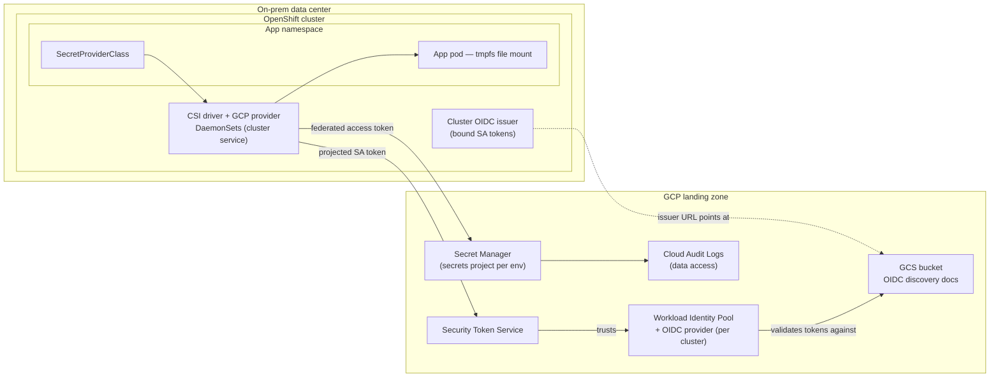

# OpenShift + GCP Secret Manager — Landing Zone Runbook

**Scope:** implement centralized secrets management for on-prem Red Hat
OpenShift clusters using Google Cloud Secret Manager and the Secrets Store CSI
Driver, integrated into the GCP landing zone. Applications consume secrets as
files from tmpfs; nothing is persisted in OpenShift etcd; no service account
keys exist anywhere.

**Prior art:** the pattern was proven end-to-end on GKE — see
[`secret-manager-poc.md`](secret-manager-poc.md). This runbook covers what is
*different* on-prem, plus the landing-zone integration work.

---

## 1. Target architecture



**Auth flow:** the provider DaemonSet presents its projected Kubernetes SA
token to GCP STS; STS validates it against the workload identity pool provider
(which trusts the cluster's OIDC issuer via the discovery docs in the bucket);
the returned federated token calls Secret Manager. Keyless end to end.

### ⚠️ The one architectural difference vs the GKE POC

On GKE, IAM sees the **application pod's** ServiceAccount (per-pod identity).
With the self-managed provider off-GKE, the token exchanged is the **provider
DaemonSet's** — so IAM granularity is **per cluster**, not per app.
Consequences and mitigations are in [§6 Guardrails](#6-guardrails--the-per-cluster-identity-gap).
(Keep per-pod ambitions in view: fleet/attached-cluster support and provider
auth modes evolve — re-check
[authentication.md](https://github.com/GoogleCloudPlatform/secrets-store-csi-driver-provider-gcp/blob/main/docs/authentication.md)
at implementation time.)

## 2. Landing-zone prerequisites

| Item | Decision / action |
|---|---|
| **Projects** | A `secrets-<env>` project per environment (dev/test/prod) holding Secret Manager secrets; a shared `identity` project holding the workload identity pools. Keeps IAM administration separable from app projects. |
| **APIs** | `secretmanager.googleapis.com`, `sts.googleapis.com`, `iamcredentials.googleapis.com` (only if impersonating GSAs), `iam.googleapis.com`. |
| **Network egress** | Cluster nodes must reach `sts.googleapis.com` and `secretmanager.googleapis.com` (TCP 443). Over Interconnect/VPN use **Private Google Access**: DNS-map `*.googleapis.com` → `private.googleapis.com` (199.36.153.8/30), or `restricted.googleapis.com` if VPC Service Controls are in scope. A corporate HTTPS proxy also works (the provider honors `HTTPS_PROXY`). |
| **The issuer bucket** | Must be readable by Google STS over the public internet (public read on two small JSON files — they contain only public keys). The *cluster* never reads it. |
| **Org policies** | Keep `iam.disableServiceAccountKeyCreation` enforced (this design needs no keys). If `iam.workloadIdentityPoolProviders` (allowed external issuers) is enforced, allowlist the issuer URLs created in Phase 1. |
| **Audit** | Enable Data Access logs for Secret Manager in each `secrets-<env>` project — every secret read becomes an audit entry attributing the cluster identity. |
| **Naming** | Secrets: `<app>-<name>` (e.g. `godev-db-password`). Pools: `ocp-<site>-pool`. Providers: one per cluster, `ocp-<cluster>`. |

## 3. Phase 1 — Give each cluster a GCP-verifiable identity

> **Maintenance-window change.** Updating `serviceAccountIssuer` invalidates
> in-flight bound SA tokens; the kube-apiserver rolls out and workloads using
> bound tokens need a restart. Same procedure class as OpenShift STS on AWS.
> If the cluster's existing issuer URL is already reachable by Google (rare
> on-prem), skip the re-issuer steps and just host nothing — go to Phase 2.

```bash
# 1. Current issuer (default on-prem: https://kubernetes.default.svc — not verifiable by GCP)
oc get authentication cluster -o jsonpath='{.spec.serviceAccountIssuer}'

# 2. Export the cluster's public signing keys
oc get --raw /openid/v1/jwks > jwks.json

# 3. Host discovery docs in a public GCS bucket (one bucket per cluster)
BUCKET=ocp-cluster1-oidc
ISSUER="https://storage.googleapis.com/${BUCKET}"
gsutil mb -p <identity-project> gs://${BUCKET}
cat > openid-configuration <<EOF
{
  "issuer": "${ISSUER}",
  "jwks_uri": "${ISSUER}/keys.json",
  "response_types_supported": ["id_token"],
  "subject_types_supported": ["public"],
  "id_token_signing_alg_values_supported": ["RS256"]
}
EOF
gsutil cp openid-configuration gs://${BUCKET}/.well-known/openid-configuration
gsutil cp jwks.json gs://${BUCKET}/keys.json
gsutil iam ch allUsers:objectViewer gs://${BUCKET}

# 4. Point the cluster at the new issuer (THE maintenance-window step)
oc patch authentication cluster --type=merge \
  -p "{\"spec\":{\"serviceAccountIssuer\":\"${ISSUER}\"}}"
# wait for kube-apiserver rollout:
oc get co kube-apiserver -w
```

**Key rotation note:** when the cluster rotates its SA signing keys, re-upload
`keys.json`. Automate with a CronJob that diffs `/openid/v1/jwks` against the
bucket.

## 4. Phase 2 — Workload Identity Pool + provider (per cluster)

```bash
ID_PROJECT=<identity-project>
ID_PROJECT_NUMBER=$(gcloud projects describe $ID_PROJECT --format='value(projectNumber)')
POOL=ocp-onprem-pool
PROVIDER=ocp-cluster1

gcloud iam workload-identity-pools create $POOL \
  --project $ID_PROJECT --location global \
  --display-name "On-prem OpenShift clusters"

gcloud iam workload-identity-pools providers create-oidc $PROVIDER \
  --project $ID_PROJECT --location global \
  --workload-identity-pool $POOL \
  --issuer-uri "${ISSUER}" \
  --allowed-audiences "https://secretmanager.ocp" \
  --attribute-mapping "google.subject=assertion.sub" \
  --attribute-condition "assertion.sub.startsWith('system:serviceaccount:secrets-store:')"
```

Decisions baked in above:

- **One provider per cluster** — lets you revoke a single cluster instantly
  (delete its provider) and keeps audit attribution clean.
- **`--allowed-audiences`** — an arbitrary constant you also set on the
  projected token in Phase 3; prevents token reuse against other relying parties.
- **`--attribute-condition`** — only tokens of ServiceAccounts in the
  `secrets-store` namespace can federate. Even a stolen token from another
  namespace is useless at STS.

The principal you will grant IAM to (note the K8s token `sub` format):

```
principal://iam.googleapis.com/projects/${ID_PROJECT_NUMBER}/locations/global/workloadIdentityPools/${POOL}/subject/system:serviceaccount:secrets-store:csi-provider-gcp
```

## 5. Phase 3 — Install the driver and the GCP provider

**5a. Secrets Store CSI Driver** — install the Red Hat **Secrets Store CSI
Driver Operator** from OperatorHub (cluster-wide), then:

```yaml
apiVersion: operator.openshift.io/v1
kind: ClusterCSIDriver
metadata:
  name: secrets-store.csi.k8s.io
spec:
  managementState: Managed
```

**5b. GCP provider DaemonSet** — deploy into a dedicated `secrets-store`
namespace (manifests from the
[provider repo](https://github.com/GoogleCloudPlatform/secrets-store-csi-driver-provider-gcp),
adapted). The pieces that differ from stock:

```yaml
# ServiceAccount whose token is federated (matches the attribute-condition + principal above)
apiVersion: v1
kind: ServiceAccount
metadata:
  name: csi-provider-gcp
  namespace: secrets-store
---
# external_account ADC config — contains NO secrets, only pointers
apiVersion: v1
kind: ConfigMap
metadata:
  name: gcp-wif-credentials
  namespace: secrets-store
data:
  config: |
    {
      "type": "external_account",
      "audience": "//iam.googleapis.com/projects/<ID_PROJECT_NUMBER>/locations/global/workloadIdentityPools/ocp-onprem-pool/providers/ocp-cluster1",
      "subject_token_type": "urn:ietf:params:oauth:token-type:jwt",
      "token_url": "https://sts.googleapis.com/v1/token",
      "credential_source": { "file": "/var/run/secrets/tokens/gcp-ksa/token" }
    }
```

In the provider DaemonSet pod spec:

```yaml
serviceAccountName: csi-provider-gcp
containers:
  - name: provider
    env:
      - name: GOOGLE_APPLICATION_CREDENTIALS
        value: /var/run/secrets/tokens/gcp-ksa/google-application-credentials.json
    volumeMounts:
      - { name: gcp-ksa, mountPath: /var/run/secrets/tokens/gcp-ksa, readOnly: true }
volumes:
  - name: gcp-ksa
    projected:
      sources:
        - serviceAccountToken:
            audience: "https://secretmanager.ocp"   # matches --allowed-audiences
            expirationSeconds: 3600
            path: token
        - configMap:
            name: gcp-wif-credentials
            items: [{ key: config, path: google-application-credentials.json }]
```

**OpenShift-specific:** the driver and provider DaemonSets need hostPath access
to the kubelet dir → privileged SCC:

```bash
oc adm policy add-scc-to-user privileged -z csi-provider-gcp -n secrets-store
```

**Rotation:** the OSS driver supports live re-fetch — enable
`--enable-secret-rotation` / `--rotation-poll-interval=2m` (via the operator's
config if exposed, else the driver DaemonSet args). Apps then see rotated
values *without restart* — better than the GKE add-on.

## 6. Guardrails — the per-cluster identity gap

Because Secret Manager sees one identity per cluster, any namespace could
otherwise mount any secret that cluster can read. Close the gap in layers:

1. **IAM (blast-radius ceiling):** grant `roles/secretmanager.secretAccessor`
   to the cluster principal **per secret** in the env's secrets project —
   never project-wide. A cluster can only ever read the union of secrets
   explicitly granted to it:
   ```bash
   gcloud secrets add-iam-policy-binding godev-db-password \
     --project secrets-prod \
     --role roles/secretmanager.secretAccessor \
     --member "principal://iam.googleapis.com/projects/${ID_PROJECT_NUMBER}/locations/global/workloadIdentityPools/${POOL}/subject/system:serviceaccount:secrets-store:csi-provider-gcp"
   ```
2. **Admission policy (namespace isolation):** enforce with Gatekeeper/Kyverno
   that a `SecretProviderClass` in namespace `X` may only reference
   `projects/*/secrets/X-*`. Namespace = app ownership boundary, same net
   effect as per-app IAM. Example Kyverno rule: deny if any
   `spec.parameters.secrets[].resourceName` does not match
   `projects/*/secrets/{{request.namespace}}-*`.
3. **RBAC:** app teams get create/update on `SecretProviderClass` only in
   their namespaces (mirror of the `role-secretproviderclass.yaml` pattern
   from the POC, GitOps-delivered).
4. **Audit:** Secret Manager data-access logs + the admission policy's audit
   mode give you both "what was read" and "who tried to cross the line".

> **If per-pod identity becomes a hard requirement:** External Secrets
> Operator supports per-namespace `SecretStore`s each federating its own
> namespace SA — true per-app IAM — at the cost of materializing values as
> Kubernetes Secrets in etcd (encrypt etcd + RBAC if you go there). Trade-off,
> not an upgrade.

## 7. Phase 4 — App onboarding (the easy part)

Per app, exactly the POC pattern with the two strings swapped:

```yaml
apiVersion: secrets-store.csi.x-k8s.io/v1
kind: SecretProviderClass
metadata:
  name: godev-secrets
  namespace: godev
spec:
  provider: gcp                      # was: gke
  parameters:
    secrets: |
      - resourceName: "projects/secrets-prod/secrets/godev-db-password/versions/latest"
        path: "db-password"
---
# Deployment volume
volumes:
  - name: gcp-secrets
    csi:
      driver: secrets-store.csi.k8s.io   # was: secrets-store-gke.csi.k8s.io
      readOnly: true
      volumeAttributes:
        secretProviderClass: godev-secrets
```

App reads `/var/secrets/db-password` as a file. The `godev` app in this repo
is the reference implementation (file read + masked status page).

## 8. Phase 5 — Validation checklist

- [ ] `oc -n secrets-store get pods` — driver + provider DaemonSets healthy on all nodes
- [ ] Test pod in a test namespace mounts a test secret (file present, correct value)
- [ ] `oc get secrets -A | grep <app>` — nothing materialized in etcd
- [ ] Negative test: SecretProviderClass referencing an *ungran­ted* secret → mount fails with `PermissionDenied`
- [ ] Negative test: SecretProviderClass referencing another namespace's secret prefix → blocked by admission policy
- [ ] Rotation: add a secret version → file updates within the poll interval, no restart
- [ ] Cloud Audit Logs show the access entries attributed to the cluster principal
- [ ] Revocation drill (non-prod): delete the cluster's WIF provider → mounts fail cluster-wide; recreate → recover

## 9. Rollout plan

1. **Dev cluster first** (Phases 1–5), including the issuer-change maintenance
   window rehearsal — this is the step with real blast radius.
2. Onboard one pilot app (godev-equivalent), run the validation checklist and
   the revocation drill.
3. Write the Kyverno/Gatekeeper policy, test in audit mode, then enforce.
4. Template Phases 2–3 (Terraform in the landing-zone repo: pool, provider,
   bucket, per-secret IAM; Helm/kustomize for the cluster components).
5. Repeat per cluster: prod clusters each get their own provider + bucket.
6. Migrate apps incrementally: for each hardcoded/unmanaged secret → create in
   Secret Manager → grant to cluster → SecretProviderClass + volume → delete
   the old Kubernetes Secret → verify etcd clean.

## 10. Reference

- Provider auth modes: [authentication.md](https://github.com/GoogleCloudPlatform/secrets-store-csi-driver-provider-gcp/blob/main/docs/authentication.md)
- WIF credential config for the provider: [fleet-wif-notes.md](https://github.com/GoogleCloudPlatform/secrets-store-csi-driver-provider-gcp/blob/main/docs/fleet-wif-notes.md)
- Red Hat: [Secret Store CSI driver on OpenShift](https://www.redhat.com/en/blog/introducing-the-secret-store-csi-driver-in-openshift)
- GKE POC this builds on: [`secret-manager-poc.md`](secret-manager-poc.md)
