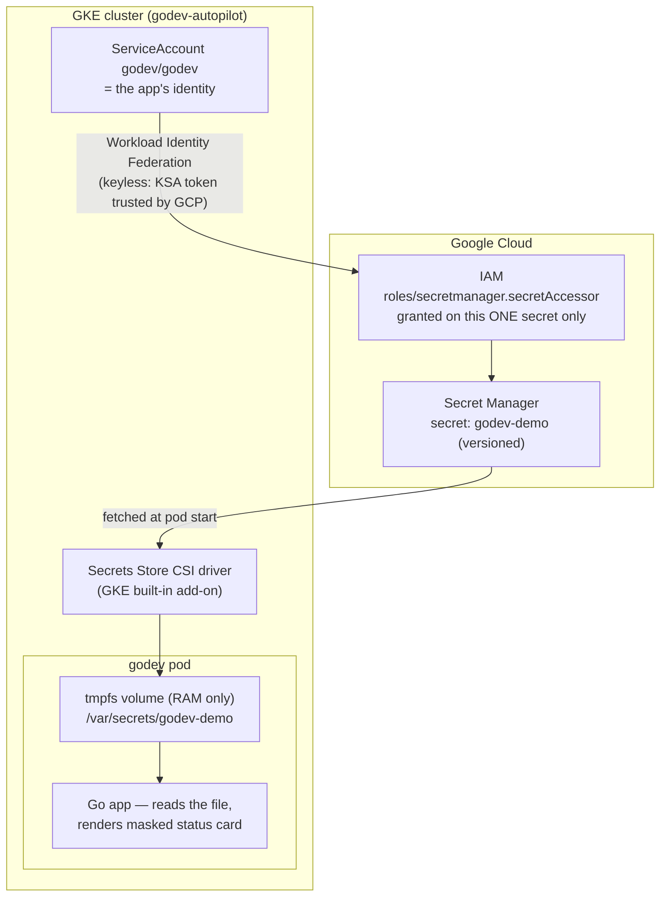

# GCP Secret Manager POC — Secrets Store CSI Driver on GKE

**Goal:** prove that applications can consume secrets from Google Cloud Secret
Manager **without storing them in the cluster** — no Kubernetes Secrets, nothing
in etcd, no service account keys, no credentials in code or git. This is the
pattern we intend to roll out to the on-prem OpenShift clusters; GKE is the POC
environment because the building blocks are identical.

**Status: working end-to-end** (verified 2026-10-25). The `godev` app serves a
page showing the secret was mounted, masked.

---

## 1. Architecture



The flow, in words:

1. The pod runs as a **dedicated Kubernetes ServiceAccount** (`godev` in
   namespace `godev`). That KSA *is* the app's identity — no Google service
   account, no JSON key anywhere.
2. **Workload Identity Federation for GKE** lets GCP IAM trust that KSA
   directly. IAM grants `roles/secretmanager.secretAccessor` to the principal
   `ns/godev/sa/godev` — scoped to the single secret `godev-demo`, not the
   project.
3. At pod start, the **Secrets Store CSI driver** authenticates as that
   identity, fetches the secret, and writes it into a **tmpfs volume** inside
   the pod sandbox. tmpfs = RAM: the value never touches etcd or node disk.
4. The app reads it as a plain file (`/var/secrets/godev-demo`). It re-reads on
   every request and renders only a **masked** preview on the page.

What the cluster stores: the *configuration* (which secret, which path, which
identity) — all in git. What it never stores: the secret *value*.

## 2. What changed, file by file

| File | Role |
|---|---|
| `main.go` | Reads `SECRET_FILE` (default `/var/secrets/godev-demo`), masks the value, passes status to the template |
| `public/index.html` | "Google Cloud Secret Manager" status card: Loaded/Not mounted, masked value, length, path |
| `config-sync/secretproviderclass.yaml` | Maps `projects/<project>/secrets/godev-demo/versions/latest` → file `godev-demo` |
| `config-sync/serviceaccount.yaml` | The dedicated `godev` KSA (the identity IAM trusts) |
| `config-sync/deployment.yaml` | `serviceAccountName: godev` + CSI volume (`secrets-store-gke.csi.k8s.io`) mounted read-only at `/var/secrets` |
| `config-sync/kustomization.yaml` | Registers the new resources; adds `SECRET_FILE` to the app ConfigMap |
| `platform/role-secretproviderclass.yaml` | Role + RoleBinding so the Config Sync reconciler may manage the SecretProviderClass CRD (the built-in `admin` ClusterRole does not cover CRDs) |
| `scripts/setup-secrets.sh` | One-shot, idempotent GCP setup: add-on + secret + IAM (details below) |

## 3. Setup steps, in order

### Step 0 — Prerequisites (already in place here)

- GKE cluster with Workload Identity enabled (Autopilot has it by default).
- `secretmanager.googleapis.com` API enabled (done by `scripts/setup-infra.sh`).
- GitOps: Config Sync RepoSync watching `config-sync/`.

### Step 1 — Enable the Secrets Store CSI driver

```bash
gcloud container clusters update godev-autopilot \
  --region us-central1 --project udc-cloud-architect-poc \
  --enable-secret-manager
```

We used the **GKE built-in Secret Manager add-on**, not the self-installed
OSS driver, because Autopilot blocks the privileged DaemonSet the OSS driver
needs. Same SecretProviderClass API; takes ~10–15 min and installs the
`secretproviderclasses.secrets-store.csi.x-k8s.io` CRD.

### Step 2 — Create the secret (value lives only in GCP)

```bash
gcloud secrets create godev-demo --replication-policy=automatic
printf '%s' "hello-from-secret-manager" | \
  gcloud secrets versions add godev-demo --data-file=-
```

### Step 3 — Grant IAM: least privilege, keyless

```bash
PROJECT_NUMBER=$(gcloud projects describe udc-cloud-architect-poc --format='value(projectNumber)')
gcloud secrets add-iam-policy-binding godev-demo \
  --role roles/secretmanager.secretAccessor \
  --member "principal://iam.googleapis.com/projects/${PROJECT_NUMBER}/locations/global/workloadIdentityPools/udc-cloud-architect-poc.svc.id.goog/subject/ns/godev/sa/godev"
```

Read that `--member` carefully — it is the heart of the design:
*"the ServiceAccount `godev` in namespace `godev` of this cluster's identity
pool"*. No intermediate Google service account, no key to create, store, or
rotate. And the binding is **on the secret resource**, not the project: this
identity can read `godev-demo` and nothing else.

> Steps 1–3 are automated by `scripts/setup-secrets.sh` (idempotent, safe to
> re-run): `PROJECT_ID=udc-cloud-architect-poc ./scripts/setup-secrets.sh`

### Step 4 — Authorize the GitOps reconciler for the new CRD

The RepoSync reconciler runs with the built-in `admin` ClusterRole, which does
**not** aggregate CRD permissions. Without this it fails with
`KNV2009 ... secretproviderclasses ... is forbidden`:

```bash
kubectl apply -f platform/role-secretproviderclass.yaml
```

(Applied manually because the `platform/` dir is not currently auto-synced —
see [Known gaps](#6-known-gaps--follow-ups).)

### Step 5 — Ship the manifests via GitOps

Push to `main`. Cloud Build builds the image and pins the tag; Config Sync
applies `config-sync/`: the KSA, the SecretProviderClass, and the Deployment
with its CSI volume:

```yaml
# deployment.yaml (the relevant part)
spec:
  serviceAccountName: godev
  containers:
    - name: godev
      volumeMounts:
        - name: gcp-secrets
          mountPath: /var/secrets
          readOnly: true
  volumes:
    - name: gcp-secrets
      csi:
        driver: secrets-store-gke.csi.k8s.io
        readOnly: true
        volumeAttributes:
          secretProviderClass: godev-secrets
```

Ordering note: a pod whose CSI volume can't mount (add-on not ready, secret or
IAM missing) stays in `ContainerCreating` — run steps 1–4 before (or while)
the rollout happens.

### Step 6 — Verify

```bash
# Pod running with the volume mounted
kubectl -n godev get pods

# Nothing in etcd — expect "No resources found"
kubectl -n godev get secrets

# The app proves the mount (the image is distroless: no shell to exec into,
# which is itself good security posture)
kubectl -n godev port-forward deploy/godev 8080:8080
# open http://localhost:8080 → card shows "Loaded", masked value, length, path
```

## 4. Security model — why each choice

| Practice | How it's implemented here |
|---|---|
| No credentials anywhere | Workload Identity Federation: GCP trusts the KSA token directly. Zero keys to leak or rotate. |
| Least privilege | One KSA per app; `secretAccessor` granted per-secret, never project-wide. Compromised pod ⇒ blast radius is its own secret. |
| No etcd persistence | CSI tmpfs mount only. We deliberately did **not** enable the driver's "sync as Kubernetes Secret" option. |
| Auditability | Every read of the secret is a Secret Manager API call → Cloud Audit Logs show which identity accessed what, when. |
| Rotation-ready | SecretProviderClass pins `versions/latest`; app re-reads the file per request. New version + pod restart = rotated (the GKE add-on fetches at pod start). |
| GitOps-safe | Git holds only references (secret *names*), never values. |

## 5. Demo plays (for the stakeholder pitch)

**Rotation:**
```bash
printf '%s' "rotated-value-42" | gcloud secrets versions add godev-demo --data-file=-
kubectl -n godev rollout restart deploy/godev
# reload the page → masked value and length change
```

**Least-privilege proof (the one security teams want to see):**
```bash
gcloud secrets remove-iam-policy-binding godev-demo \
  --role roles/secretmanager.secretAccessor --member "principal://...same as step 3..."
kubectl -n godev rollout restart deploy/godev
# pod stuck ContainerCreating, events show PermissionDenied → re-add binding to restore
```

## 6. Known gaps / follow-ups

- **`platform/` is not GitOps-synced.** Fleet Config Management reports
  `NOT_CONFIGURED`; the platform resources (RepoSync, RoleBindings) were
  applied by hand. Re-run the Config Sync section of `scripts/setup-infra.sh`
  (or wire a RootSync) to make the platform layer declarative too.
- **Rotation requires a pod restart** with the GKE add-on (it fetches at pod
  start). The self-installed driver supports periodic re-fetch
  (`--rotation-poll-interval`) — relevant for OpenShift, where we'll run the
  OSS driver anyway.
- The demo shows a **masked** value by design; real apps would parse/use the
  file content and display nothing.

## 7. Path to on-prem OpenShift (the real target)

The manifests and the IAM model carry over almost verbatim. Three work items:

1. **Install the driver** — Secrets Store CSI Driver Operator from OperatorHub
   (Red Hat supported), plus the GCP provider plugin DaemonSet.
2. **Workload Identity Federation for the cluster** — the on-prem equivalent
   of what GKE gave us for free:
   - expose the OpenShift cluster's OIDC issuer (public endpoint or a GCS
     bucket holding the discovery docs),
   - create a **workload identity pool + OIDC provider** in GCP pointing at it,
   - IAM grant becomes the same `principal://` line, just referencing your
     pool instead of `<project>.svc.id.goog`.
3. **Two-string manifest diff:**

   | | GKE (this POC) | OpenShift |
   |---|---|---|
   | `SecretProviderClass.spec.provider` | `gke` | `gcp` |
   | Pod volume `csi.driver` | `secrets-store-gke.csi.k8s.io` | `secrets-store.csi.k8s.io` |

Everything else — per-app KSA, per-secret IAM, tmpfs mount, file-based
consumption, GitOps delivery — is identical. That is what this POC was for.
